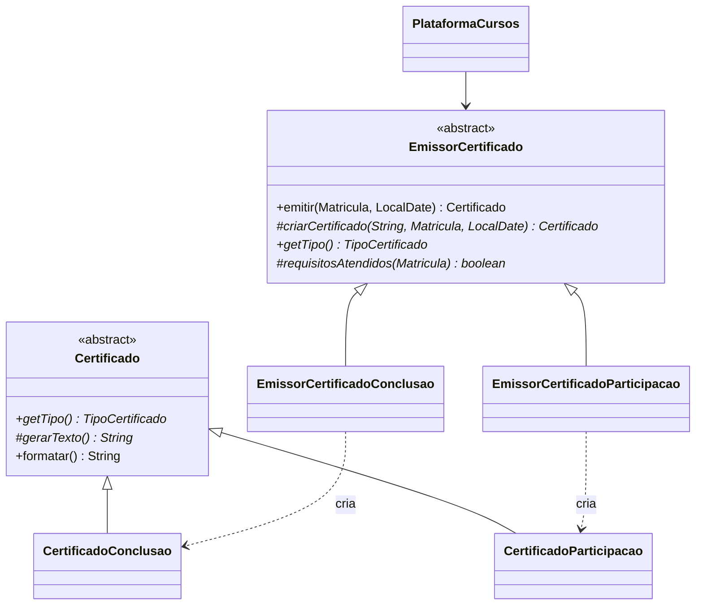
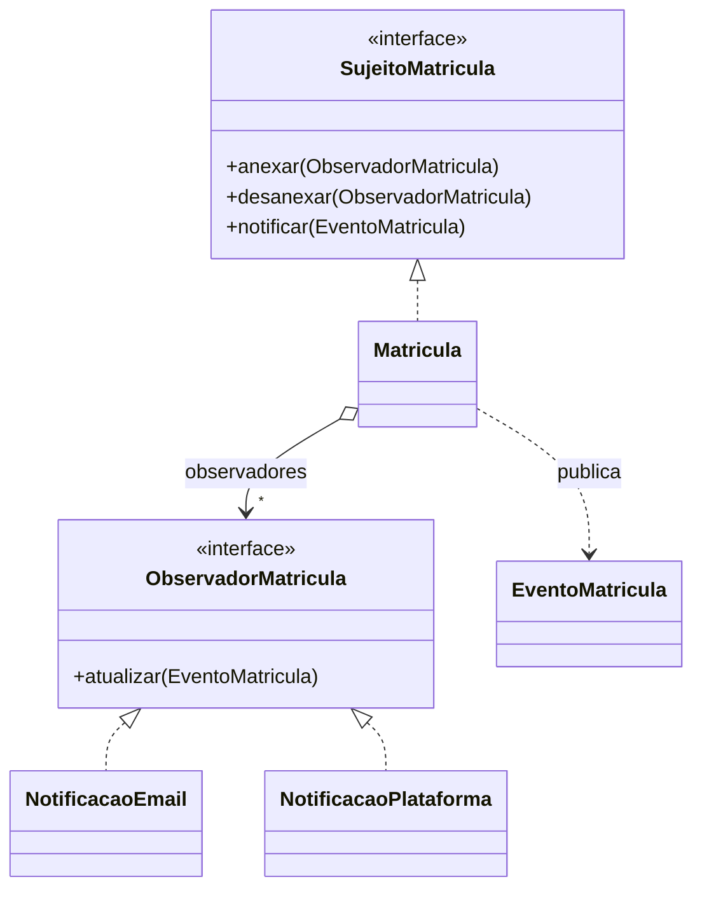

# Plataforma de Cursos

Projeto final da disciplina de **Design Patterns** — Tema 9: **Plataforma de cursos**.

Aplicação de console em Java que permite cadastrar cursos e alunos, matricular alunos,
acompanhar o progresso, cancelar matrículas e emitir certificados. Os alunos são
notificados automaticamente a cada mudança relevante na matrícula.

| Entidades principais | Patterns |
| --- | --- |
| `Curso`, `Aluno`, `Matricula` | **Factory Method** + **Observer** |

---

## Sumário

- [Descrição do sistema](#descrição-do-sistema)
- [Tecnologias e pré-requisitos](#tecnologias-e-pré-requisitos)
- [Como executar](#como-executar)
- [Exemplos de uso](#exemplos-de-uso)
- [Patterns utilizados](#patterns-utilizados)
- [Estrutura do projeto](#estrutura-do-projeto)
- [Pontos de extensão (Parte 2)](#pontos-de-extensão-parte-2)
- [Declaração de uso de IA](#declaração-de-uso-de-ia)
- [Contribuição dos integrantes](#contribuição-dos-integrantes)

---

## Descrição do sistema

Fluxo de ponta a ponta:

1. **Cadastro** de cursos (título, carga horária e tipo de certificado) e de alunos (nome e e-mail).
2. **Matrícula** do aluno em um curso → o aluno recebe as boas-vindas por e-mail e na plataforma.
3. **Registro de progresso** (0–100%). Ao chegar em 100% a matrícula é **concluída** automaticamente.
4. **Emissão do certificado**, cujo tipo depende do curso:
   - **Conclusão** — exige o curso 100% concluído (cursos formais);
   - **Participação** — exige no mínimo 75% de participação (workshops, palestras).
5. **Cancelamento** de matrícula ativa (matrícula cancelada não gera certificado).

Regras de negócio implementadas:

- e-mail de aluno é único e validado;
- um aluno não pode ter duas matrículas não canceladas no mesmo curso;
- o progresso só avança (não pode regredir nem passar de 100%);
- cada matrícula recebe no máximo um certificado;
- o código do certificado segue o formato `PREFIXO-ANO-MATRICULA` (ex.: `CONC-2026-00001`).

Os dados ficam **apenas em memória** (sem banco de dados, conforme o enunciado). Ao iniciar,
a aplicação carrega alguns cursos e alunos de exemplo.

## Tecnologias e pré-requisitos

- **Java 17** ou superior (JDK — é preciso ter `javac` e `java` no `PATH`).
- Nenhuma dependência externa: apenas a biblioteca padrão do Java.
- Opcional: **Maven 3.8+**, caso prefira gerar o `.jar` pelo `pom.xml`.

Verifique a instalação com:

```bash
java -version
javac -version
```

## Como executar

### Linux / macOS

```bash
./run.sh            # menu interativo
./run.sh --demo     # executa o fluxo completo automaticamente
./test.sh           # executa as verificações automatizadas
```

### Windows

No **PowerShell** é preciso prefixar o script com `.\` (no Prompt de Comando, `cmd`, não):

```powershell
.\run.bat
.\run.bat --demo
.\test.bat
```

Se aparecer `'javac' não é reconhecido`, o JDK não está no `PATH`. Para a sessão atual do
PowerShell, aponte para a pasta `bin` do seu JDK, por exemplo:

```powershell
$env:PATH = "C:\caminho\para\jdk-17\bin;$env:PATH"
```

### Front-end web

```bash
./run.sh --web          # Linux / macOS
.\run.bat --web         # Windows (PowerShell)
.\run.bat --web 9090    # em outra porta, se a 8080 estiver ocupada
```

Abra http://localhost:8080 (ou a porta escolhida). No modo web a aplicação também cria três
matrículas de exemplo (uma concluída com certificado, uma em andamento e uma cancelada). A página (`src/main/resources/web/index.html`) permite cadastrar
e listar cursos e alunos, matricular, registrar progresso, cancelar, emitir/ver certificados
e ver as notificações de cada aluno. O servidor (`web/ServidorWeb.java`) usa apenas o
`HttpServer` do JDK e expõe uma API JSON sobre a `PlataformaCursos`.

### Com Maven (opcional)

```bash
mvn package
java -jar target/plataforma-cursos.jar --demo
```

### Manualmente, só com o JDK

```bash
javac -encoding UTF-8 -d out/main $(find src/main/java -name "*.java")
java -cp out/main br.com.plataformacursos.Main --demo
```

## Exemplos de uso

### Menu interativo

```
=== Plataforma de Cursos ===

 1. Listar cursos
 2. Listar alunos
 3. Cadastrar aluno
 4. Cadastrar curso
 5. Matricular aluno em curso
 6. Registrar progresso
 7. Emitir certificado
 8. Cancelar matrícula
 9. Listar matrículas
10. Ver notificações de um aluno
 0. Sair
```

Exemplo de sessão (matricular, concluir e emitir o certificado):

```
Escolha uma opção: 5
  #1 Ana Souza <ana.souza@email.com>
  #2 Bruno Lima <bruno.lima@email.com>
ID do aluno: 1
  #1 Java Orientado a Objetos (40h) - certificado de Conclusão
  #2 Design Patterns na Prática (60h) - certificado de Conclusão
  #3 Workshop de Git e GitHub (8h) - certificado de Participação
ID do curso: 2
  [E-mail] Para: ana.souza@email.com | Assunto: [Matrícula confirmada] Design Patterns na Prática | Bem-vindo(a) ao curso Design Patterns na Prática!
  [Plataforma] Ana Souza -> 10/11 11:23 - Matrícula confirmada: Bem-vindo(a) ao curso Design Patterns na Prática!
Matrícula realizada: #1 Ana Souza em "Design Patterns na Prática" - 0% - Ativa

Escolha uma opção: 6
ID da matrícula: 1
Novo progresso (0-100): 100
  [Plataforma] Ana Souza -> 10/11 11:23 - Progresso atualizado: Progresso atualizado para 100%.
  [E-mail] Para: ana.souza@email.com | Assunto: [Curso concluído] Design Patterns na Prática | Parabéns! Você concluiu o curso Design Patterns na Prática.
  [Plataforma] Ana Souza -> 10/11 11:23 - Curso concluído: Parabéns! Você concluiu o curso Design Patterns na Prática.

Escolha uma opção: 7
ID da matrícula: 1
  [E-mail] Para: ana.souza@email.com | Assunto: [Certificado disponível] ... Código: CONC-2026-00001.
  [Plataforma] Ana Souza -> ... Certificado disponível: Seu certificado de Conclusão foi emitido. Código: CONC-2026-00001.
================================================================
                    CERTIFICADO DE CONCLUSÃO
================================================================
Certificamos que Ana Souza concluiu com êxito o curso "Design Patterns na Prática",
com carga horária total de 60 horas.

Emitido em: 10/11/2026
Código de verificação: CONC-2026-00001
================================================================
```

Tentativa de emitir certificado sem cumprir o requisito:

```
Erro: Requisito não atendido para certificado de Participação: é necessário ter no mínimo 75% de participação (progresso atual: 60%).
```

### Modo demonstração

`./run.sh --demo` executa sozinho o roteiro completo: matrícula, progresso, conclusão,
certificado de conclusão, tentativa inválida, certificado de participação, cancelamento
e caixa de entrada do aluno.

### Verificações automatizadas

`./test.sh` executa 19 verificações (Java puro, sem framework) cobrindo os dois patterns, as regras de negócio
e a API web (o servidor sobe numa porta livre e as rotas são chamadas de verdade):

```
[OK]    matrícula notifica observadores
[OK]    conclusão automática ao atingir 100%
[OK]    e-mail ignora atualização de progresso
...
[OK]    API web executa o fluxo até o certificado
...
19 verificações aprovadas, 0 falharam.
```

## Patterns utilizados

Foram aplicados **somente** os dois patterns definidos para o tema.

### 1. Factory Method — emissão de certificados

**Problema resolvido:** cada curso emite um tipo diferente de certificado, com regras de
elegibilidade e textos diferentes. Sem o pattern, o serviço teria um `if/switch` por tipo
para decidir qual classe instanciar e qual regra validar, e cada novo tipo exigiria alterar
esse código. Com o Factory Method, o fluxo de emissão fica centralizado no *Creator* e a
decisão de **qual certificado criar** fica em cada subclasse.

| Papel no pattern | Classe |
| --- | --- |
| Product | `certificado.Certificado` (abstrata) |
| ConcreteProduct | `certificado.CertificadoConclusao`, `certificado.CertificadoParticipacao` |
| Creator | `certificado.EmissorCertificado` (abstrata) — operação `emitir(...)` usa o factory method |
| Factory method | `EmissorCertificado.criarCertificado(codigo, matricula, data)` |
| ConcreteCreator | `certificado.EmissorCertificadoConclusao`, `certificado.EmissorCertificadoParticipacao` |
| Cliente | `servico.PlataformaCursos` — conhece apenas `EmissorCertificado` e `Certificado` |

`EmissorCertificado.emitir(...)` valida a matrícula, gera o código, chama o factory method
e vincula o certificado criado à matrícula. Os emissores concretos são registrados em
`Main` (`plataforma.registrarEmissor(...)`) e a plataforma escolhe o emissor pelo
`TipoCertificado` do curso.



### 2. Observer — notificações da matrícula

**Problema resolvido:** quando a matrícula muda (é criada, avança, é concluída, recebe
certificado ou é cancelada), vários canais precisam reagir. Sem o pattern, a matrícula ou o
serviço chamariam cada canal diretamente, ficando acoplados a todos eles. Com o Observer, a
matrícula apenas publica o evento e os canais interessados reagem, podendo ser
adicionados ou removidos sem alterar a matrícula.

| Papel no pattern | Classe |
| --- | --- |
| Subject | `notificacao.SujeitoMatricula` (interface: `anexar`, `desanexar`, `notificar`) |
| ConcreteSubject | `dominio.Matricula` |
| Observer | `notificacao.ObservadorMatricula` (interface: `atualizar(EventoMatricula)`) |
| ConcreteObserver | `notificacao.NotificacaoEmail`, `notificacao.NotificacaoPlataforma` |
| Dados do evento | `notificacao.EventoMatricula` (record) e `notificacao.TipoEvento` (enum) |

- `NotificacaoEmail` simula o envio de e-mail apenas nos marcos importantes
  (matrícula, conclusão, certificado e cancelamento).
- `NotificacaoPlataforma` registra **todos** os eventos na caixa de entrada do aluno
  (opção 10 do menu), inclusive atualizações de progresso.

Os observadores são registrados em `Main` (`plataforma.registrarObservador(...)`) e a
`PlataformaCursos` os anexa a cada nova matrícula.



### Como os dois patterns se conectam

Ao emitir um certificado, o *Creator* (`EmissorCertificado`) vincula o certificado à
matrícula; a matrícula, como *Subject*, publica o evento `CERTIFICADO_EMITIDO` e os
observadores avisam o aluno. Assim, um novo tipo de certificado já é notificado por todos
os canais existentes, e um novo canal já recebe os eventos de todos os tipos de certificado.

## Estrutura do projeto

```
src/main/java/br/com/plataformacursos/
├── Main.java                       # monta a aplicação (registra emissores e observadores)
├── dominio/                        # entidades
│   ├── Aluno.java
│   ├── Curso.java
│   ├── Matricula.java              # ConcreteSubject (Observer)
│   └── StatusMatricula.java
├── certificado/                    # Factory Method
│   ├── Certificado.java            # Product
│   ├── CertificadoConclusao.java   # ConcreteProduct
│   ├── CertificadoParticipacao.java# ConcreteProduct
│   ├── EmissorCertificado.java     # Creator
│   ├── EmissorCertificadoConclusao.java    # ConcreteCreator
│   ├── EmissorCertificadoParticipacao.java # ConcreteCreator
│   └── TipoCertificado.java
├── notificacao/                    # Observer
│   ├── SujeitoMatricula.java       # Subject
│   ├── ObservadorMatricula.java    # Observer
│   ├── NotificacaoEmail.java       # ConcreteObserver
│   ├── NotificacaoPlataforma.java  # ConcreteObserver
│   ├── EventoMatricula.java
│   └── TipoEvento.java
├── servico/
│   ├── PlataformaCursos.java       # regras e orquestração do fluxo (em memória)
│   └── RegraNegocioException.java
├── console/
│   ├── MenuConsole.java            # menu interativo
│   ├── Demonstracao.java           # fluxo automático (--demo)
│   └── DadosIniciais.java          # dados de exemplo
└── web/
    └── ServidorWeb.java            # API JSON + página (--web), só com o HttpServer do JDK
src/main/resources/web/
└── index.html                      # front-end (HTML, CSS e JS, sem dependências)
src/test/java/br/com/plataformacursos/
└── VerificacoesPlataforma.java     # verificações automatizadas
```

## Pontos de extensão (Parte 2)

A extensão esperada para o tema é **um novo tipo de certificado** e **uma nova notificação**.

**Novo tipo de certificado (Factory Method):**

1. adicionar a constante em `TipoCertificado` (descrição e prefixo do código);
2. criar a subclasse de `Certificado` com o texto do novo certificado;
3. criar a subclasse de `EmissorCertificado` implementando `criarCertificado`, `getTipo`,
   `requisitosAtendidos` e `descricaoRequisito`;
4. registrar o novo emissor em `Main` e cadastrar um curso com o novo tipo.

**Nova notificação (Observer):**

1. criar uma classe que implemente `ObservadorMatricula`;
2. registrá-la em `Main` com `plataforma.registrarObservador(...)`.

Nenhuma alteração em `Matricula` ou em `PlataformaCursos` é necessária nos dois casos.

## Declaração de uso de IA

Conforme permitido pelo enunciado para a Parte 1:

- **Modelo utilizado:** Claude Opus 5.5 (Anthropic), via Claude Code.
- **Partes em que foi utilizado:** estrutura inicial do projeto, implementação das classes
  de domínio, dos dois patterns, do serviço, do menu de console, do front-end web
  e da API, das verificações automatizadas, dos scripts de execução e redação deste README.
- Todo o código foi revisado pela equipe, que é responsável por explicá-lo.

## Contribuição dos integrantes

| Integrante | GitHub | Contribuição |
| --- | --- | --- |
| Gustavo Dias | [@gustavofelisbino](https://github.com/gustavofelisbino) | Estrutura inicial do projeto, entidades, Factory Method, Observer e README |
| _Integrante 2_ | _@usuario_ | _a preencher_ |
| _Integrante 3_ | _@usuario_ | _a preencher_ |
| _Integrante 4_ | _@usuario_ | _a preencher_ |

> Cada integrante deve ter pelo menos um commit autoral com sua própria conta GitHub.
